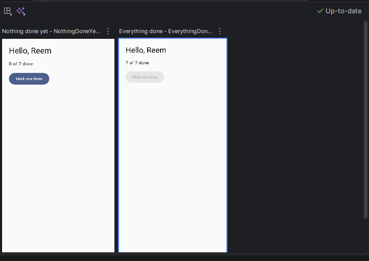
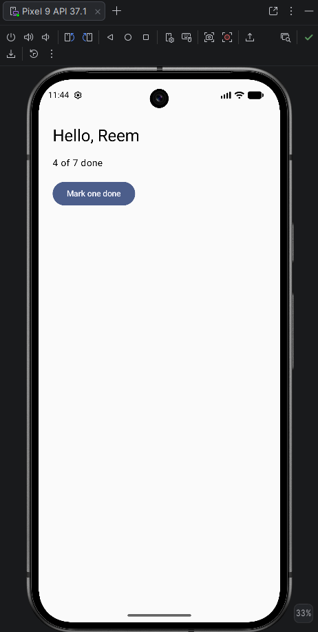

# Lab 4 — Semester App, Part 1 (Study Planner)

CSC 402 · Mobile Application Programming · Reem AlShehab

Home screen of the Study Planner app, built with a UI state class, a stateless screen composable, two previews, and a Route that owns the state.

## What's inside
- `StudyPlanner/` — the Android Studio project (package `sa.edu.iau.cshj.studyplanner`, min SDK 26, Material 3)
- `StudyPlanner/app/src/main/java/sa/edu/iau/cshj/studyplanner/ui/PlannerHomeScreen.kt` — `PlannerUiState`, `PlannerHomeScreen`, `PlannerHomeRoute`, and both previews
- `screenshots/` — previews and the running app

## State list (P1.1)
- **Shows:** greeting, total number of tasks, number done, a "Mark one done" button
- **Changes while running:** number done (and whether the button is enabled)
- **User action:** tap the button → `onMarkDoneClick`

## Previews — "Nothing done yet" and "Everything done"

## Running app after the button was tapped

